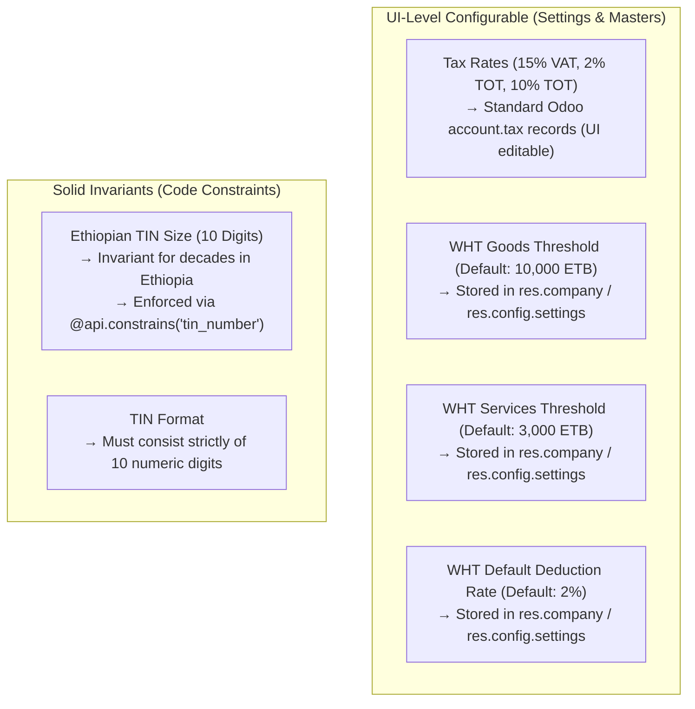

# 10-Day Ethiopian Accounting Localization Plan
*Odoo 18.0 Community — Practical Implementation & Learning Schedule*

## 1. Architectural Design Principle: UI-Configurable vs. Hardcoded Invariants

To ensure the localization adapts cleanly to future Ethiopian legislative updates without requiring code changes, we adhere strictly to this design principle:



---

## 2. 10-Day Schedule Overview

| Day | Focus Area | Key Deliverable | UI-Configurable Parameters |
| :-: | :--- | :--- | :--- |
| **Day 1** | **TIN & Settings Foundation** | Scaffold `l10n_et_tax`, 10-digit TIN validation, Ethiopian Settings panel in UI | Ethiopian Settings page in Accounting Settings |
| **Day 2** | **VAT & TOT** | Configure 15% VAT, 0% Export, Exempt & 2%/10% Turnover Tax | Rates & Accounts fully editable under *Accounting -> Taxes* |
| **Day 3** | **Withholding Tax** | Automated 2% WHT deduction based on configurable thresholds | Goods limit (10k), Services limit (3k), and WHT rate (2%) in UI |
| **Day 4** | **WHT Certificate** | Official printable Ministry of Revenues (MOR) WHT Receipt | Certificate numbering sequence & issuer info |
| **Day 5** | **Voucher Models** | Scaffold `l10n_et_vouchers` (CPV, CRV, BPV, PCV) | Journals & Accounts mapped via UI |
| **Day 6** | **Approval Flow** | 4-stage workflow (*Draft -> Checked -> Approved -> Paid*) | Approval limit amounts & User groups |
| **Day 7** | **Bilingual Vouchers** | Amharic/English amount-in-words & printable PDF with 4 signatures | Signature titles & company header |
| **Day 8** | **Ethiopian Calendar** | Python conversion engine for 13-month Ge'ez Calendar | Leap year & month names |
| **Day 9** | **Dual Dating** | Dual GC/EC date display & Ethiopian fiscal month periods | Fiscal Year date bounds (Hamle 1 – Sene 30) |
| **Day 10** | **Enterprise Simulation** | Full simulated Ethiopian enterprise business cycle in ETB | End-to-end verification and review |

---

## 3. Day 1 Specification: `l10n_et_tax` Foundation

### 3.1 10-Digit TIN Validation (`res.partner`)
- In Ethiopia, every taxpayer is assigned a **10-digit Tax Identification Number (TIN)**.
- **Python Invariant Constraint**:
  ```python
  @api.constrains('tin_number')
  def _check_tin_number(self):
      for partner in self:
          if partner.tin_number:
              cleaned = partner.tin_number.strip()
              if len(cleaned) != 10 or not cleaned.isdigit():
                  raise ValidationError(_(
                      "Invalid Ethiopian TIN Number '%s'! "
                      "An Ethiopian TIN must consist of exactly 10 numeric digits."
                  ) % partner.tin_number)
  ```

### 3.2 UI-Configurable Ethiopian Settings (`res.company` & `res.config.settings`)
Exposed in **Settings -> Accounting -> Ethiopian Tax Localization**:
- `et_wht_enabled`: Enable/disable automatic Withholding Tax calculations.
- `et_wht_goods_threshold`: Minimum bill amount for goods to trigger WHT (default: `10000.00 ETB`).
- `et_wht_services_threshold`: Minimum bill amount for services to trigger WHT (default: `3000.00 ETB`).
- `et_wht_rate`: Withholding tax percentage (default: `2.0%`).
- `et_wht_tax_id`: The withholding tax record to apply on qualifying bills.
- `et_wht_journal_id`: The journal for recording tax withholdings.
- `et_wht_officer_name`: Authorized tax officer name printed on WHT certificates.
- `et_wht_officer_title`: Authorized officer title printed on WHT certificates.

---

## 4. Day 4 Specification: Official MOR Withholding Tax Certificate (`l10n_et_tax`)

### 4.1 Legal Mandate
Under the **Federal Income Tax Proclamation No. 979/2016** (Articles 88–93) and Council of Ministers Regulation No. 410/2017:
- Any business or withholding agent deducting 2% Withholding Tax from suppliers (Goods $\ge$ 10,000 ETB, Services $\ge$ 3,000 ETB) must provide an official **Withholding Tax Receipt (የተቀናሽ ግብር ደረሰኝ)** to the payee.
- Suppliers rely on this official certificate to submit to the Ministry of Revenues (MOR) to claim tax credits against their annual corporate profit tax.

### 4.2 Technical Architecture & Deliverables
1. **Sequential Certificate Numbering (`ir.sequence`)**:
   - Code: `l10n_et_tax.wht.receipt`
   - Format: `WHT/%(year)s/00001`
   - Generated automatically when vendor bills with WHT are confirmed (`action_post`), or manually via `action_generate_wht_receipt()`.
   - Also supports manual booklet serial numbers (`wht_manual_receipt_number`) for companies utilizing pre-printed MOR paper pads.
2. **Bilingual Amount-in-Words Converter (`amount_to_text_am.py`)**:
   - Converts monetary ETB amounts into official Amharic financial wording:
     - Example: `15,432.75 ETB` $\rightarrow$ *"አስራ አምስት ሺህ አራት መቶ ሰላሳ ሁለት ብር ከሰባ አምስት ሳንቲም ብቻ"*
   - In English: *"Fifteen Thousand Four Hundred Thirty-Two Birr and Seventy-Five Cents Only"*
3. **Official Printable QWeb PDF Report (`action_report_wht_receipt`)**:
   - Layout matching the Ministry of Revenues standard format:
     - Ministry Header (Federal Democratic Republic of Ethiopia Ministry of Revenues / የገቢዎች ሚኒስቴር).
     - Withholding Agent (Company) TIN, VAT Reg No, Registered Address.
     - Payee (Supplier) Name, 10-digit TIN, VAT Reg No, Address.
     - Transaction summary: Gross Untaxed, Base for WHT, Rate (2%), Withheld Amount, Net Disbursed.
     - Withheld amount printed in both Amharic & English words.
     - Legal declaration and 3 signature blocks (Prepared By, Authorized Officer, Official Seal / Stamp).
4. **WHT Receipts Dashboard**:
   - Direct menu in Invoicing: **Vendors $\rightarrow$ WHT Receipts (የተቀናሽ ደረሰኝ)**.
   - Filter and review all WHT receipts issued in any tax period, with one-click reprint.

---

## 5. Day 5 Specification: Ethiopian Financial Vouchers (`l10n_et_vouchers`)

### 5.1 Business Context & Statutory Mandate
In Ethiopia, internal financial controls and external statutory audits governed by the **Accounting & Auditing Board of Ethiopia (AABE)** require dedicated payment and receipt vouchers with strict sequential numbering, multi-account breakdown, and dual-currency text representation before funds are disbursed or acknowledged.

### 5.2 The 4 Ethiopian Voucher Types
1. **CPV (Cash Payment Voucher / የጥሬ ገንዘብ ክፍያ ማዘዣ)**:
   - Covers all direct cash payments from the cashier/safe.
   - Tied to cash journals.
   - Sequential format: `CPV/%(year)s/00001`.
2. **CRV (Cash Receipt Voucher / የጥሬ ገንዘብ መቀበያ ሰነድ)**:
   - Acknowledges all cash receipts deposited into the main cashier.
   - Tied to cash journals.
   - Sequential format: `CRV/%(year)s/00001`.
3. **BPV (Bank Payment Voucher / የባንክ ክፍያ ማዘዣ / ቼክ)**:
   - Manages payments disbursed via Bank Cheque, CPO (Certified Payment Order), or Electronic Bank Transfer (CBE, Awash, Telebirr, etc.).
   - Captures cheque leaf number, cheque date, and beneficiary bank details.
   - Tied to bank journals.
   - Sequential format: `BPV/%(year)s/00001`.
4. **PCV (Petty Cash Voucher / የጥቃቅን ወጪ ማዘዣ)**:
   - Manages day-to-day petty cash disbursements under the imprest fund system.
   - Sequential format: `PCV/%(year)s/00001`.

### 5.3 Technical Architecture & Deliverables
- **Data Models**: `et.voucher` and `et.voucher.line`.
- **Automatic Double-Entry General Ledger Posting**:
  - Payment (`cpv`, `bpv`, `pcv`): Debit line accounts (Expenses/Payables/Assets), Credit Journal default liquidity account (Cash/Bank).
  - Receipt (`crv`): Debit Journal default liquidity account (Cash/Bank), Credit line accounts (Revenue/Receivables).
- **Sequences**: 4 independent `ir.sequence` records for CPV, CRV, BPV, and PCV.
- **Dedicated Menus**: Main menu **Vouchers (የክፍያ ሰነዶች)** under Invoicing with filtered sub-actions for each voucher type.
- **Smart Link**: Direct navigation between Voucher and created `account.move` Journal Entry.
