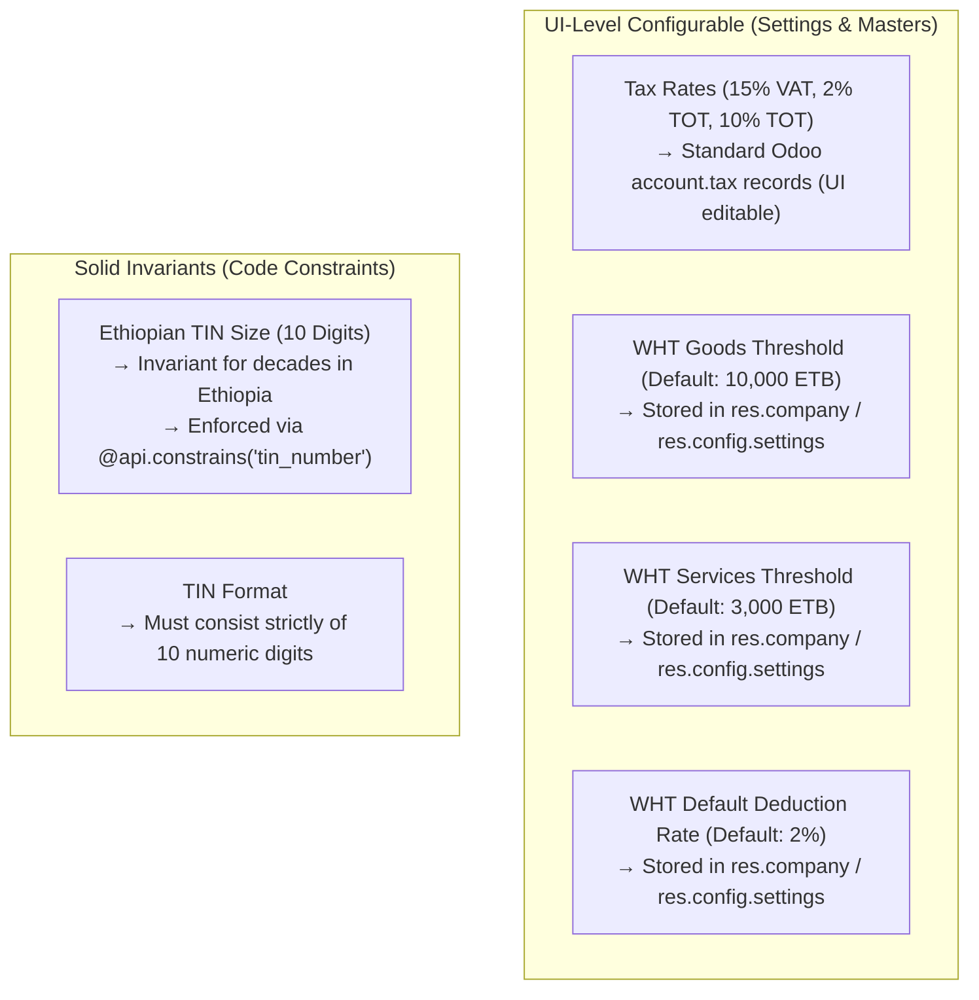

# 10-Day Ethiopian Accounting Localization Plan
*Odoo 18.0 Community — Practical Implementation & Learning Schedule*

## 1. Architectural Design Principle: UI-Configurable vs. Hardcoded Invariants

To ensure the localization adapts cleanly to future Ethiopian legislative updates without requiring code changes, we adhere strictly to this design principle:



---

## 2. 10-Day Schedule Overview

| Day | Focus Area | Key Deliverable | UI-Configurable Parameters |
| :-: | :--- | :--- | :--- |
| **Day 1** | **TIN & Settings Foundation** | Scaffold `l10n_et_tax`, 10-digit TIN validation, Ethiopian Settings panel in UI | Ethiopian Settings page in Accounting Settings |
| **Day 2** | **VAT & TOT** | Configure 15% VAT, 0% Export, Exempt & 2%/10% Turnover Tax | Rates & Accounts fully editable under *Accounting -> Taxes* |
| **Day 3** | **Withholding Tax** | Automated 2% WHT deduction based on configurable thresholds | Goods limit (10k), Services limit (3k), and WHT rate (2%) in UI |
| **Day 4** | **WHT Certificate** | Official printable Ministry of Revenues (MOR) WHT Receipt | Certificate numbering sequence & issuer info |
| **Day 5** | **Voucher Models** | Scaffold `l10n_et_vouchers` (CPV, CRV, BPV, PCV) | Journals & Accounts mapped via UI |
| **Day 6** | **Approval Flow** | 4-stage workflow (*Draft -> Checked -> Approved -> Paid*) | Approval limit amounts & User groups |
| **Day 7** | **Bilingual Vouchers** | Amharic/English amount-in-words & printable PDF with 4 signatures | Signature titles & company header |
| **Day 8** | **Ethiopian Calendar** | Python conversion engine for 13-month Ge'ez Calendar | Leap year & month names |
| **Day 9** | **Dual Dating** | Dual GC/EC date display & Ethiopian fiscal month periods | Fiscal Year date bounds (Hamle 1 – Sene 30) |
| **Day 10** | **Enterprise Simulation** | Full simulated Ethiopian enterprise business cycle in ETB | End-to-end verification and review |

---

## 3. Day 1 Specification: `l10n_et_tax` Foundation

### 3.1 10-Digit TIN Validation (`res.partner`)
- In Ethiopia, every taxpayer is assigned a **10-digit Tax Identification Number (TIN)**.
- **Python Invariant Constraint**:
  ```python
  @api.constrains('tin_number')
  def _check_tin_number(self):
      for partner in self:
          if partner.tin_number:
              cleaned = partner.tin_number.strip()
              if len(cleaned) != 10 or not cleaned.isdigit():
                  raise ValidationError(_(
                      "Invalid Ethiopian TIN Number '%s'! "
                      "An Ethiopian TIN must consist of exactly 10 numeric digits."
                  ) % partner.tin_number)
  ```

### 3.2 UI-Configurable Ethiopian Settings (`res.company` & `res.config.settings`)
Exposed in **Settings -> Accounting -> Ethiopian Tax Localization**:
- `et_wht_enabled`: Enable/disable automatic Withholding Tax calculations.
- `et_wht_goods_threshold`: Minimum bill amount for goods to trigger WHT (default: `10000.00 ETB`).
- `et_wht_services_threshold`: Minimum bill amount for services to trigger WHT (default: `3000.00 ETB`).
- `et_wht_rate`: Withholding tax percentage (default: `2.0%`).
- `et_wht_tax_id`: The withholding tax record to apply on qualifying bills.
- `et_wht_journal_id`: The journal for recording tax withholdings.
